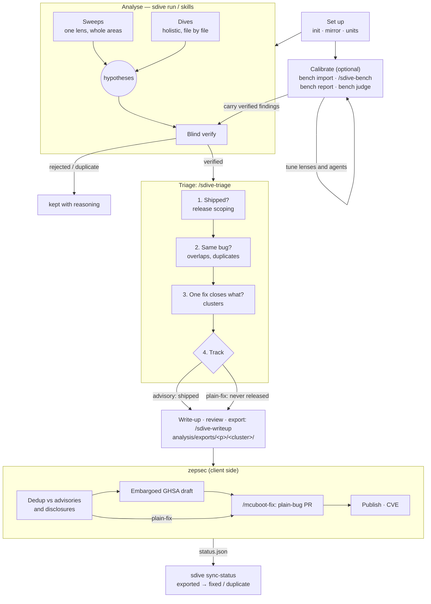

# The security-dive process

How a project goes from source code to fixed, disclosed vulnerabilities, and
which `sdive` command or skill does each step. `PLAN.md` is the design and the
reasons behind it; this file is the operating manual. Steps marked
**(to build)** are agreed but not implemented yet.

All commands are run as `uv run sdive …` from the repo root. Add
`--ledger <name>` (before the subcommand) to work in a disposable ledger such
as a benchmark round; the default is `main`.

## tl;dr

```
# 1. Set up (once per project, then mirror again for new commits and tags)
sdive init
sdive mirror <p>
sdive units <p> [REV]

# 2. Calibrate (optional; blind benchmark at a commit with known answers)
sdive bench import <p> <corpus>... --name <set>
/sdive-bench <p> <set> --rev <commit>
sdive --ledger <round> bench report <p> <set> --rev <commit>
sdive --ledger <round> bench judge <p> <set> <item> <slug>...
sdive carry <p> --from <round>

# 3. Analyse (repeat until the queue is empty)
sdive todo <p>
sdive run <p> [auto|sweep|dive|verify] [LENS] [--minutes M]
    (or interactively: /sdive-sweep, /sdive-dive, /sdive-verify, which use
     sdive next / brief / record / abandon)
sdive coverage <p>
sdive findings <p>

# 4. Triage (interactive: proposes each decision, records what you approve)
/sdive-triage <p>
    (status at any time: sdive triage <p>; the commands it uses are in §4)

# 5. Write up and export (interactive: drafts, you review, it exports)
/sdive-writeup <p> [cluster...|N]
    (status at any time: sdive writeups <p>; the commands it uses are in §5)

# 6. zepsec, client side (zepsec's skills): dedup, GHSA draft, fix, CVE

# 7. Status back
sdive sync-status <p>
```

## Flow



---

## 1. Set up

| Command | What it does |
|---|---|
| `sdive init` | Creates `analysis/` (private, its own nested git repo, never published) and `work/` (disposable), and the main ledger `analysis/sdive.db`. |
| `sdive mirror <p>` | Creates or fetches the project's bare mirror in `work/mirrors/`, using the user's checkout only as a `--reference`. Fetches branches and tags. Run it again before analysing new commits or scoping against a new release. |
| `sdive units <p> [REV]` | Exports a read-only snapshot of REV (default: the default branch) to `work/snapshots/<p>/<sha>/` and indexes its files and functions by area (tree-sitter). `sdive snapshot` only exports. |
| `sdive lenses <p>` | Lists lenses and their content hashes. Editing a lens makes a new version, and coverage under the old version no longer counts for it. |

Per-project configuration: `config.toml` (repos, paths, threat model) and
`projects/<p>/project.toml` (scope globs, areas and their priorities,
reference trees, `sweep_order`). Lenses live in `projects/<p>/lenses/`. The
agents' threat model is `projects/<p>/threat-model.md`.

Never write to the user's own source checkouts; everything reads the mirror
and snapshots.

## 2. Calibrate (optional)

A **blind benchmark round** runs the current lenses and agents at a commit
whose vulnerabilities are already known, then scores the result. Use it
before trusting a lens or prompt change on current code.

| Step | What it does |
|---|---|
| `sdive bench import <p> <corpus>... --name <set>` | Imports ground truth from zepsec-style analysis directories into `analysis/truth/<p>/<set>.json`. |
| `/sdive-bench <p> <set> --rev <commit>` | Creates a fresh ledger (`bench-<set>-<date>`), runs sweeps and dives at `<commit>`, verifies every hypothesis, then scores. |
| `sdive --ledger <round> bench report <p> <set> --rev <commit>` | Scores the round: location matches against truth items are only *candidates*. |
| `sdive --ledger <round> bench judge <p> <set> <item> <slug>...` | Records, by human judgement, which findings really raise each truth item (`adjudication.json`). |
| `sdive carry <p> --from <round>` | Copies the round's verified findings into the main ledger as hypotheses at `main`, with locations remapped, so ordinary verification shows which are still live. |

**Blindness.** No analysis agent may see the truth set or zepsec's analysis
trees. A PreToolUse hook (`src/security_dive/blind.py`) refuses `sdive-*`
agents' reads and broad searches of those paths, and `sdive run` hard-denies
them for the whole headless session. Interactive sessions can read them (for
scoring and export), so an interactive orchestrator running analysis keeps to
this by rule. Only `bench report` reads the truth, and only after a round.

## 3. Analyse

Analysis runs as Claude Code skills that dispatch the `sdive-auditor` and
`sdive-verifier` subagents. `sdive` does the bookkeeping and makes no model
calls itself.

**Kinds of run:**

- **Sweep:** one focused lens (memory-safety, authenticity, recovery,
  upgrade-state, rollback, secrets) over a few whole areas per run, covering
  the uncovered in-scope code. Broad and cheap per line.
- **Dive:** the holistic lens over the uncovered functions of the
  highest-priority file. Deep.
- **Verify:** one hypothesis (only the claim and its locations) given to a
  blind verifier that tries to refute it. Verdicts are verified, rejected,
  duplicate or inconclusive (back to hypothesis).

| Command | What it does |
|---|---|
| `sdive todo <p> [--minutes M]` | Work left per kind and lens, with agent-minute estimates from past runs. |
| `sdive run <p> [auto\|sweep\|dive\|verify] [LENS] [--minutes M \| --runs N] [--parallel P]` | Launches a headless Claude session on the matching skill. `auto` runs verify first, then the next lens in `sweep_order` with work left, then dives. Progress streams to the terminal; the log and reported cost go to the ledger's `sessions/`. `-i` opens an interactive session instead; `--dry-run` prints the command. |
| `/sdive-sweep <p> <lens\|all> [N\|all] [--minutes M]` | The sweep skill, run interactively. |
| `/sdive-dive <p> [N\|all] [--minutes M]` | The dive skill. |
| `/sdive-verify <p> [N\|all] [--minutes M]` | The verify skill. |
| `sdive coverage <p>` | Per-area function coverage at the snapshot (current content hashes only: changed code loses its coverage). |
| `sdive findings <p> [--status S]` | Lists findings. `sdive finding show <slug>` gives one, with locations and history, as JSON. |
| `sdive upstream <p>` | Suspected defects noted in external (reference) components. |
| `sdive runs <p>` | Recent runs. |

The skills use the low-level commands, which can also be used by hand:

- `sdive next <p> --kind K --lens L` starts a run, leases its targets for 12
  hours, and prints the brief.
- `sdive brief <run>` reprints the brief.
- The agent writes its result JSON to the ledger's staging directory.
  `sdive schema audit|verify` prints the result schema.
- `sdive record <run>` validates the result and applies it: coverage,
  hypotheses, dossier notes and upstream notes.
- `sdive abandon <run>` releases a started run's targets.

A stopped session is always safe to resume. Runs left `started` are tidied by
the skills: they record the run if a result file exists, and abandon it
otherwise.

Finding lifecycle: `hypothesis → verified | rejected | duplicate → exported →
fixed`, or `exported → duplicate` when zepsec finds an existing advisory
already covers it. Rejections and duplicates keep their reasoning.

## 4. Triage

Turns verified findings into **clusters**: the findings one fix closes. A
cluster is the unit of one fix PR, one advisory and one CVE. Triage answers
four questions about each verified finding, in this order:

1. **Did the buggy code ship in a release?** Release scoping, deterministic.
2. **Is it the same bug as another finding?** Missed duplicates, judgement.
3. **Which fix closes it, and what else does that fix close?** Clusters,
   judgement.
4. **Advisory or plain fix?** The cluster's track, your decision, normally
   following from 1.

**How to run it:** `/sdive-triage <p>`, in an interactive session. It works
through `sdive triage`'s steps in order, reads the claims and the code,
proposes each decision as the exact command plus a short reason (in batches
of up to six), and runs only what you approve. Stop any time; the next run
picks up where the ledger stands. `sdive triage <p>` alone shows what's left.

### The steps `sdive triage` tracks

| Step | Left when | What decides it |
|---|---|---|
| `scope` | a verified finding has no release scoping at its snapshot | nothing: `sdive mirror <p>` then `sdive scope <p>` |
| `overlaps` | two verified findings share lines (or a function) and at least one is in no cluster; once both are clustered the pair counts as decided | read both claims: **duplicate** (one defect, described twice), **one fix** (same cluster) or **separate** (distinct defects in shared code, which is common) |
| `cluster` | a verified finding is in no cluster | join an existing cluster or start one (the CVE counting rule below) |
| `empty` | a cluster has no members (after a merge or a duplicate) | drop it |
| `track` | a cluster has no track | its shape first (split? merge?), then the track from its scope |
| `check` | a track contradicts its scope (`advisory` but `post-release`, `plain-fix` but `released`) | decide the track again |

**The CVE counting rule.** Zephyr, MCUboot's CNA, wants one CVE per
independently fixable flaw. Join findings in a cluster only when one natural
change *necessarily* fixes them all; if the fixes could land separately, they
are separate clusters. Most clusters hold one finding.

**Release scoping** blames each finding's locations at its snapshot
(`git blame -w -M -C`) and maps each commit to the first `vX.Y.Z` tag holding
it. Verdicts: `released` (every flagged line, as it reads now, was in the
latest release), `post-release` (none was), `mixed` (read the post-release
commits: they are often changes around the defect, not the defect itself),
`unknown` (nothing blamable, e.g. a submodule path). `as_is_since` is an upper
bound on when the bug arrived, not the advisory's floor.

**Track** follows the disclosure policy in `PLAN.md`: code that shipped in a
release → `advisory`; merged since the last release and never shipped →
`plain-fix` (an ordinary fix, no GHSA or CVE). The note records the evidence.
Changing a cluster's membership clears its track, since the decision was about
a different set of findings.

### Commands (what the skill runs; usable directly)

| Command | Does |
|---|---|
| `sdive triage <p> [--json]` | What's left at each step, and the next thing to do. |
| `sdive findings <p> --status verified` | The verified findings and their slugs. |
| `sdive finding show <slug>` | One finding: claim, locations, history (JSON). |
| `sdive overlaps <p> [--json]` | Pairs of verified findings sharing lines (or, failing that, a function); pairs in one cluster last. |
| `sdive scope <p> [slug...] [--redo] [--json]` | Release scoping; `--json` lists each location's blamed commits, marked `post_release`. |
| `sdive finding set <slug> --status duplicate --of <orig> [--note N]` | Marks `<slug>` a duplicate of `<orig>` (the one kept); it leaves any cluster. |
| `sdive cluster new <p> <cluster> <slug>... --title T [--rationale R] [--move]` | Starts a cluster. |
| `sdive cluster add <cluster> <slug>... [--move]` / `cluster remove <cluster> <slug>...` | Changes membership (`--move` takes a finding from another cluster). |
| `sdive cluster edit <cluster> [--title T] [--rationale R]` / `cluster drop <cluster>` | Edits a cluster; deletes an empty one. |
| `sdive cluster track <cluster> advisory\|plain-fix --note N` | Records the track and its evidence. |
| `sdive clusters <p>` / `sdive cluster show <cluster>` | Clusters with track, combined scope and release range, then findings in none; one cluster as JSON. |

## 5. Write up and export

Turns each tracked cluster into an advisory draft, and an approved draft into
a local export for zepsec. **How to run it:** `/sdive-writeup <p>` in an
interactive session, naming clusters or a count, or with neither to be offered
a batch. `sdive writeups <p>` shows where every tracked cluster stands.

1. **Draft.** `sdive writeup brief <cluster>` writes a brief for the
   `sdive-writer` subagent, which is blind like the analysis agents. The brief
   holds the cluster (its rationale is the one fix; its track note is the
   release evidence) and, per member, the claim, auditor notes, locations,
   the verifier's reasoning, and the release-scoping blame. The writer re-reads
   the code and writes zepsec's MCUboot verdict fields:
   - `is_vulnerability`, `property_violated`, `attacker_class`, `vuln_class`,
     `cwe`
   - `severity`, `cvss_vector`
   - `attacker_reachable`, `reachable_surface`, `affected_components`,
     `affected_functions`
   - `introduced_by`, `affected_versions`, `reportable`, `reportable_reason`
   - `advisory_summary` and `advisory_description` (GHSA Markdown)
   - `confidence`, `evidence`, `rationale`

   It adds sdive's own fields: `affected_configurations`, `recommended_fix`
   (which briefs the fix author) and `open_questions`.
2. **Record.** `sdive writeup record <cluster>` validates the draft and
   stores it as a new version. sdive scores the CVSS 3.1 vector itself, and
   `severity` must be its GitHub band. `reportable` must match the track
   (`advisory` → true, `plain-fix` → false with a post-release-only reason).
   Every cited component must exist in the snapshot, and no absolute or local
   path may appear in the text, since the text is published. A rejected draft
   goes back to the writer with the reasons.
3. **Review.** `sdive writeup show <cluster> [--version N] [--json]` renders
   the draft exactly as it will be exported. You approve it, ask for changes
   (the writer revises from the previous version plus your feedback; `writeup
   brief --feedback` does the same in a later session), or skip it.
   `sdive writeup approve <cluster> [--version N] [--note N]` records the
   approval.
4. **Export.** `sdive export <p> [cluster...]` writes the approved version to
   `analysis/exports/<p>/<cluster>/`, or every approved cluster when none is
   named:
   - `cluster.json`: the verdict fields at the top level (so zepsec's filing
     tools read it as a `result.json`), plus `cvss_score`, the cluster and its
     track, the snapshot `sha`, the members (claims, locations, verify runs,
     scope, `carried_from`) and provenance (write-up version and approval,
     origin runs, the models that found and verified the members, for the
     advisory's credit, and the sdive commit);
   - `cluster.md`: the same, readable.

   The member findings move to `exported`. The export stays on this machine:
   it never goes to zepsec's prod Instance, and it is built from the ledger
   alone, so it never contains truth-set content.

A write-up belongs to the members it was written for. If the cluster's
membership changes afterwards (which also clears its track), the write-up is
`stale` and must be drafted again. States in `sdive writeups`:
`needs-writeup`, `stale`, `draft`, `approved`, `exported`. Approving a new
version of an exported cluster makes it `approved` again, ready to re-export.

| Command | Does |
|---|---|
| `sdive writeups <p> [--json]` | Each tracked cluster (the slugs `/sdive-writeup` takes), highest priority first, with its score, attacker class, state, write-up version, exported version and title. Priority is the CVSS score (the write-up's once there is one, else the highest of the members' verifier vectors), ties going to the weaker attacker class; `/sdive-writeup <p> N` takes the first `N` not yet exported. |
| `sdive writeup brief <cluster> [--feedback F]` | Writes the writer's brief to staging and prints it. |
| `sdive writeup record <cluster> [--file F]` | Validates the writer's result and stores a new version. |
| `sdive writeup show <cluster> [--version N] [--json]` | The draft as it will be exported. |
| `sdive writeup approve <cluster> [--version N] [--note N]` | Approves a version for export. |
| `sdive export <p> [cluster...]` | Writes approved write-ups to `analysis/exports/<p>/<cluster>/`; members → `exported`. |
| `sdive schema writeup` | The JSON schema the writer's result must satisfy. |

## 6. zepsec, client side

zepsec's work, not sdive's; its brief is `../zepsec/sdive-intake.md`. A local
intake channel on the zepsec client copies each export into a local-only unit
(nothing derived from an export goes to zepsec's prod Instance). It dedups
against the project's advisories and related corpora, then runs the pre-fix
flow:

- **`advisory` clusters:** embargoed GHSA draft → `/mcuboot-fix` (a plain-bug
  PR from the user's fork) → merge → publish → CVE (Zephyr is MCUboot's CNA).
- **`plain-fix` clusters:** only the fix.

sdive's blind verification is trusted: zepsec does not re-validate.

Fix commits and PRs use plain bug-fix wording: nothing from `analysis/`, no
security framing while the advisory is embargoed.

## 7. Status back

zepsec writes `status.json` beside each export it acts on, and rewrites it at
each step. `sdive sync-status <p>` reads them all and records each change
(table `cluster_status`), so the ledger stays the single place that tracks
every finding's state:

- **`duplicate`** (an existing advisory already covers the cluster): the
  members move `exported → duplicate`, with the GHSA id as `duplicate_of`.
  They stay in their cluster.
- **`fix-merged`**, or **`published`** with fix SHAs: the members move
  `exported → fixed`.
- **`received`, `drafted`, `fix-open`, `declined`**: noted in the members'
  history (with the GHSA and CVE ids); no status change.

A status names the export it refers to by `export_hash` (the first 32 hex
characters of the SHA-256 of `cluster.json`) and `writeup_version`. One that
matches no export sdive wrote is refused; one that refers to an older export
than the latest is recorded and flagged, since zepsec has not picked up the
re-export yet. Unchanged files are skipped. `sdive writeups <p>` shows each
cluster's zepsec state and GHSA id.

**The contract.** Both hand-off documents are JSON Schemas committed in
`schemas/`: `sdive-export-1.schema.json` (`cluster.json`) and
`zepsec-status-1.schema.json` (`status.json`, with the cross-field rules in
its description). `sdive export` validates every export against its schema
before writing it, and `sdive sync-status` validates every status. Changing
either means bumping the schema string, regenerating with
`sdive schema --write`, and telling zepsec; a test fails while the committed
files are stale.

| Command | Does |
|---|---|
| `sdive sync-status <p> [--json]` | Reads every `status.json` under `analysis/exports/<p>/`, records changes, moves findings to `fixed` / `duplicate`. |
| `sdive schema export\|status` | Prints a hand-off schema; `sdive schema --write` regenerates `schemas/`. |

## Change findings (Phase 3, to build)

Unmerged PRs and newly merged commits get their own review flow; see
`PLAN.md`, *Disclosure policy for change findings*. A finding in an unmerged
PR becomes a PR comment, shown to the user before posting.
